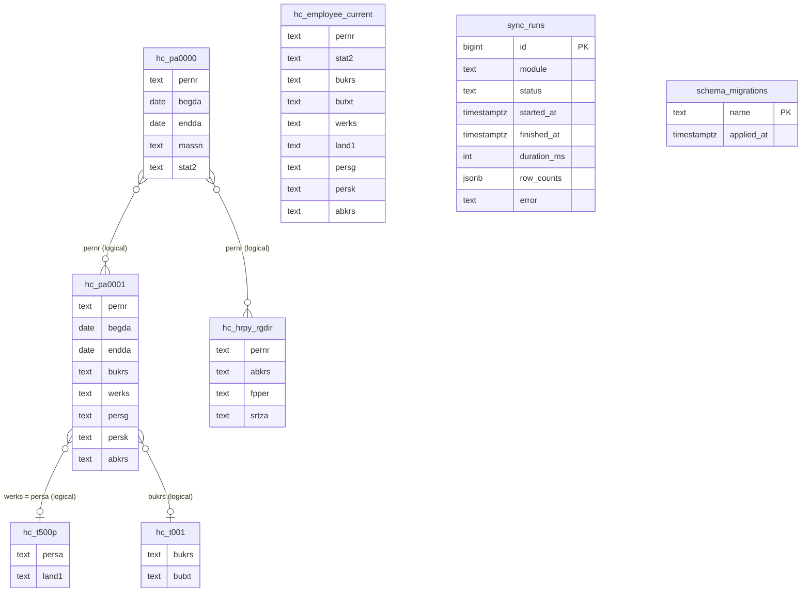

# Database Schema (PostgreSQL)

Verified by inspecting a database migrated with both migrations (`psql \d` output), PostgreSQL 16.

## 1. Architecture

- One PostgreSQL database (default name `hr_kpi`). One schema (`public`). Plain `pg` driver, **no ORM**.
- **Staging tables** (`hc_*` = headcount section) are a typed, **full-replace copy** of the SAP tables: on every sync they are `TRUNCATE`d and refilled inside **one transaction**.
  They are re-creatable from SAP; they are not a history store and not a cache that is read *instead of* SAP on the first read.
- **A view** (`hc_employee_current`) does the per-employee join; every KPI (except payroll and the PA0000-only hire counts) reads it.
- **Bookkeeping tables:** `sync_runs` (history of sync attempts), `schema_migrations` (applied migration files).
- No foreign keys, no triggers, no stored functions/procedures, no sequences besides `sync_runs.id`, no seed data (verified: 0 functions, 0 triggers, 0 FKs).
  Absence of FKs is deliberate: staging tables mirror SAP and may contain orphans (e.g. PA0001 PERNRs not in PA0000, which the view drops on purpose).
- Naming: table prefix = KPI module prefix (`hc_`). A new KPI section adds its own prefixed tables via a new migration.

## 2. ER diagram

Relationships below are **logical** (shared keys), not enforced constraints.



`hc_employee_current` is a **view** over `hc_pa0000`, `hc_pa0001`, `hc_t500p`, `hc_t001` (see section 5).

## 3. Tables

All SAP-derived columns are `text` (trimmed; empty string stored as `NULL`) except dates, which are `date` (SAP `YYYYMMDD` → ISO; `00000000`/invalid → `NULL`; `99991231` kept).
Rows lacking the "required" column (below) are skipped by the loader without a warning.

### 3.1 `sync_runs` (migration 001)

| Column | Type | Null | Default | Notes |
|---|---|---|---|---|
| `id` | `bigserial` | no | sequence | **PK** `sync_runs_pkey` |
| `module` | `text` | no | | KPI module name, e.g. `headcount` |
| `status` | `text` | no | | **CHECK** `status IN ('running','success','failed')` |
| `started_at` | `timestamptz` | no | `now()` | |
| `finished_at` | `timestamptz` | yes | | |
| `duration_ms` | `integer` | yes | | |
| `row_counts` | `jsonb` | yes | | rows loaded per staging table, e.g. `{"pa0000":16,...}` |
| `error` | `text` | yes | | truncated to 2000 chars |

Index: `sync_runs_module_idx (module, id DESC)`. At server start, rows still `running` are set to `failed` ("Interrupted (server restarted)").

### 3.2 `schema_migrations` (created by `migrate.js` code, **not** by a SQL file)

`name text PK`, `applied_at timestamptz not null default now()`.

### 3.3 `hc_pa0000`: copy of SAP `PA0000` (migration 001)

| Column | Type | Null | SAP field | Notes |
|---|---|---|---|---|
| `pernr` | text | **no** | `PERNR` | required |
| `begda` | date | yes | `BEGDA` | start date; hire year is derived from it |
| `endda` | date | yes | `ENDDA` | end date; used to pick the current record |
| `massn` | text | yes | `MASSN` | action type; hire detection |
| `stat2` | text | yes | `STAT2` | employment status 0-3 |

Indexes: `hc_pa0000_pernr_idx (pernr)`, `hc_pa0000_massn_idx (massn)`. Multiple rows per `pernr` expected.

### 3.4 `hc_pa0001`: copy of SAP `PA0001` (migration 001)

`pernr text NOT NULL`, `begda date`, `endda date`, `bukrs text`, `werks text` (personnel area), `persg text`, `persk text`, `abkrs text`. Index `hc_pa0001_pernr_idx (pernr)`. Multiple rows per `pernr` expected.

### 3.5 `hc_t500p`: copy of SAP `T500P` (001 created `werks`; **002 renamed it to `persa`**)

`persa text` (personnel area key; SAP `PERSA`), `land1 text` (country code). Index `hc_t500p_persa_idx (persa)` (renamed from `hc_t500p_werks_idx` in 002). Both columns nullable; loader requires `persa`.

### 3.6 `hc_t001`: copy of SAP `T001`

`bukrs text`, `butxt text`. Index `hc_t001_bukrs_idx (bukrs)`. Loader requires `bukrs`.

### 3.7 `hc_hrpy_rgdir`: copy of SAP `HRPY_RGDIR`

`pernr text NOT NULL`, `abkrs text`, `fpper text` (period `YYYYMM`), `srtza text`. Index `hc_hrpy_rgdir_fpper_idx (fpper)`.

### 3.8 `hcm_t582a`: copy of SAP `T582A` (migration 003)

`infty text NOT NULL`. Index `hcm_t582a_infty_idx (infty)`. Required: `infty`. Holds infotype definitions.

### 3.9 `hcm_t591a`: copy of SAP `T591A` (migration 003)

`infty text NOT NULL`, `subty text`. Index `hcm_t591a_infty_idx (infty)`. Required: `infty`. Holds subtype definitions per infotype.

### 3.10 `hcm_t582s`: copy of SAP `T582S` (migration 003)

`sprsl text`, `infty text NOT NULL`, `itext text`. Index `hcm_t582s_infty_sprsl_idx (infty, sprsl)`. Required: `infty`. Holds infotype texts in multiple languages (filtered by `sprsl = 'EN'`).

### 3.11 Primary keys, foreign keys, constraints (complete list)

- PKs: `sync_runs.id`, `schema_migrations.name`. Staging tables have **no PK** (SAP infotype tables legitimately repeat PERNR).
- FKs: none. CHECK: `sync_runs_status_check`. NOT NULL: `*.pernr` in `hc_pa0000/hc_pa0001/hc_hrpy_rgdir`, `sync_runs.module/status/started_at`.
- Types: `date` columns are returned to Node as `'YYYY-MM-DD'` strings (type parser OID 1082) to avoid timezone shifting; `bigint` as JS number (OID 20).

## 4. Migrations

| File | Applied change |
|---|---|
| `src/db/migrations/001_init.sql` | `sync_runs` + index; staging tables `hc_pa0000`, `hc_pa0001`, `hc_t500p` (with `werks`), `hc_t001`, `hc_hrpy_rgdir` + indexes; view `hc_employee_current` (joining T500P on `werks`) |
| `src/db/migrations/002_t500p_persa.sql` | Owner correction: `ALTER TABLE hc_t500p RENAME COLUMN werks TO persa`; `ALTER INDEX hc_t500p_werks_idx RENAME TO hc_t500p_persa_idx`; `CREATE OR REPLACE VIEW hc_employee_current` joining `t5.persa = p1.werks` |
| `src/db/migrations/003_hcm_core.sql` | HCM Core staging tables: `hcm_t582a`, `hcm_t591a`, `hcm_t582s` + indexes |
| `src/db/migrations/004_t777d.sql` | HCM Core infotype table: `hcm_t777d` + indexes |
| `src/db/migrations/005_pa.sql` | PA staging tables: `pa_t582a`, `pa_t777d`, `pa_t588m`, `pa_t588z` + indexes |
| `src/db/migrations/006_om.sql` | OM staging tables: `om_t778o`, `om_t778v`, `om_t778a`, `om_hrp1000`, `om_hrp1001`, `om_t778p`, `om_t77pq`, `om_t77ua` + indexes |
| `src/db/migrations/007_pe.sql` | PE staging tables: `pe_t549a`, `pe_t549r`, `pe_pa0001`, `pe_t549n`, `pe_t549b`, `pe_t549c`, `pe_t549d`, `pe_t512w`, `pe_t500l`, `pe_pa0008`, `pe_pa0014`, `pe_pa0015`, `pe_pa0267`, `pe_t512t` + indexes |
| `src/db/migrations/008_t500t_t777p.sql` | Replace T500L with `pe_t500t` (`spras, molga, ltext`) and T778P with `om_t777p` (`spras, plvar, ptext`) + indexes |
| `src/db/migrations/009_pe_ext.sql` | PE extension tables: `pe_t52c0`, `pe_t52c1`, `pe_t52c5`, `pe_t52a0`, `pe_t599b`, `pe_hrpy_rgdir` + indexes |

Runner (`src/db/migrate.js`): ensures the database exists (on error `3D000` connects to `PG_ADMIN_DATABASE` and runs `CREATE DATABASE`), creates `schema_migrations`, then applies every
not-yet-applied `*.sql` in filename order, **each in its own transaction**, recording it. Runs automatically on `npm start`; manually via `npm run db:setup`.
**Rules:** never edit an applied migration; add `003_*.sql`; test the upgrade path on a database that already has the previous migrations. Verified: a database migrated at 001 (with old data) upgrades cleanly to 002.
Pending database changes: none (see CURRENT_STATUS.md).

## 5. The view: `hc_employee_current` (definition as of migration 002; the inline comments are added for this document)

```sql
CREATE OR REPLACE VIEW hc_employee_current AS
WITH p0 AS (   -- latest PA0000 record per employee: the employee universe + status
  SELECT DISTINCT ON (pernr) pernr, stat2
  FROM hc_pa0000
  ORDER BY pernr, endda DESC NULLS LAST, begda DESC NULLS LAST
),
p1 AS (        -- latest PA0001 record per employee
  SELECT DISTINCT ON (pernr) pernr, bukrs, werks, persg, persk, abkrs
  FROM hc_pa0001
  ORDER BY pernr, endda DESC NULLS LAST, begda DESC NULLS LAST
),
t5 AS (        -- one country per personnel area
  SELECT DISTINCT ON (persa) persa, land1
  FROM hc_t500p
  ORDER BY persa, land1
),
t1 AS (        -- one name per company code
  SELECT DISTINCT ON (bukrs) bukrs, butxt
  FROM hc_t001
  ORDER BY bukrs, butxt
)
SELECT p0.pernr, p0.stat2, p1.bukrs, t1.butxt, p1.werks, t5.land1, p1.persg, p1.persk, p1.abkrs
FROM p0
LEFT JOIN p1 ON p1.pernr = p0.pernr
LEFT JOIN t5 ON t5.persa = p1.werks
LEFT JOIN t1 ON t1.bukrs = p1.bukrs;
```

Business rules encoded here: (1) the **employee universe is PA0000 only** (a PERNR present only in PA0001 never appears); (2) "current" = latest `ENDDA`, then latest `BEGDA`, nulls last (today's date is *not* considered);
(3) LEFT JOINs keep employees with no PA0001 row or unmapped plant/company (they surface as `NULL` → "Unknown" in the API); (4) T500P/T001 are de-duplicated so a repeated key cannot multiply employees.

## 6. Important SQL (from `src/modules/headcount/headcount.repository.js`)

All parameterised. Aggregations run in the database; labels/country names are added in Node.

```sql
-- status counts (distinct PERNR via the view)
SELECT stat2 AS code, COUNT(*)::int AS employees FROM hc_employee_current GROUP BY stat2;

-- by country / by company code
SELECT land1 AS code, COUNT(*)::int AS employees FROM hc_employee_current GROUP BY land1;
SELECT bukrs AS code, MIN(butxt) AS name, COUNT(*)::int AS employees FROM hc_employee_current GROUP BY bukrs;

-- employee table (filters optional; 'UNKNOWN' matches unmapped country/company; $4 = PERNR prefix)
SELECT pernr, stat2, bukrs, butxt, werks, land1, persg, persk, abkrs, COUNT(*) OVER()::int AS total_count
  FROM hc_employee_current
 WHERE ($1::text IS NULL OR stat2 = $1)
   AND ($2::text IS NULL OR ($2 = 'UNKNOWN' AND land1 IS NULL) OR land1 = $2)
   AND ($3::text IS NULL OR ($3 = 'UNKNOWN' AND bukrs IS NULL) OR bukrs = $3)
   AND ($4::text IS NULL OR pernr ILIKE $4 || '%')
 ORDER BY pernr LIMIT $5 OFFSET $6;

-- payroll: distinct employees per period present ($1 = optional SRTZA filter array; empty = no filter)
SELECT fpper AS period, COUNT(DISTINCT pernr)::int AS employees
  FROM hc_hrpy_rgdir
 WHERE fpper IS NOT NULL AND (cardinality($1::text[]) = 0 OR srtza = ANY($1::text[]))
 GROUP BY fpper ORDER BY fpper;

-- hires per year ($1 = HIRE_MASSN_CODES array, default {'01'}); distinct PERNR per year of BEGDA
SELECT EXTRACT(YEAR FROM begda)::int AS year, COUNT(DISTINCT pernr)::int AS hires
  FROM hc_pa0000 WHERE massn = ANY($1::text[]) AND begda IS NOT NULL GROUP BY 1 ORDER BY 1;

-- hires per year and (current) country
WITH hires AS (SELECT DISTINCT pernr, EXTRACT(YEAR FROM begda)::int AS year
                 FROM hc_pa0000 WHERE massn = ANY($1::text[]) AND begda IS NOT NULL)
SELECT h.year, e.land1 AS code, COUNT(*)::int AS hires
  FROM hires h LEFT JOIN hc_employee_current e ON e.pernr = h.pernr
 GROUP BY h.year, e.land1 ORDER BY h.year;

-- ---------------------------------------------------------------------------
-- HCM Core module queries (src/modules/hcm_core/hcm_core.repository.js)
-- ---------------------------------------------------------------------------

-- distinct infotypes from T777D
SELECT DISTINCT infty FROM hcm_t777d WHERE infty IS NOT NULL ORDER BY infty;

-- subtype count per infotype from T591A
SELECT infty, COUNT(DISTINCT subty)::int AS subtype_count
  FROM hcm_t591a
 WHERE infty IS NOT NULL AND subty IS NOT NULL
 GROUP BY infty
 ORDER BY infty;

-- infotype summary table with subtype count and English text (SPRSL = 'E')
WITH infotypes AS (
  SELECT DISTINCT infty FROM hcm_t777d WHERE infty IS NOT NULL
),
subtypes AS (
  SELECT infty, COUNT(DISTINCT subty)::int AS subtype_count
    FROM hcm_t591a
   WHERE infty IS NOT NULL AND subty IS NOT NULL
   GROUP BY infty
),
texts AS (
  SELECT DISTINCT ON (infty) infty, itext
    FROM hcm_t582s
   WHERE sprsl = 'E' AND infty IS NOT NULL
   ORDER BY infty, itext
)
SELECT i.infty, COALESCE(s.subtype_count, 0) AS subtype_count, t.itext
  FROM infotypes i
  LEFT JOIN subtypes s ON s.infty = i.infty
  LEFT JOIN texts t ON t.infty = i.infty
 ORDER BY i.infty;

-- ---------------------------------------------------------------------------
-- PA module queries (src/modules/pa/pa.repository.js)
-- ---------------------------------------------------------------------------

-- 1. Screen classifications (single & list screens from T582A)
SELECT infty, edynr, ldynr FROM pa_t582a WHERE infty IS NOT NULL ORDER BY infty;

-- 2. Module pool mapping (T588M REPNA where DYNNR != ADYNR mapped to T777D)
WITH t777 AS (
  SELECT DISTINCT repid, infty FROM pa_t777d WHERE repid IS NOT NULL AND repid <> ''
)
SELECT t.infty, m.repna AS module_pool
  FROM pa_t588m m
  INNER JOIN t777 t ON t.repid = m.repna
 WHERE m.dynnr IS NOT NULL AND m.adynr IS NOT NULL
   AND m.dynnr <> '' AND m.adynr <> '' AND m.dynnr <> m.adynr
 ORDER BY t.infty, m.repna;

-- 3. Field visibility summary (DBILD indicator symbols per infotype)
WITH t777 AS (
  SELECT DISTINCT repid, infty FROM pa_t777d WHERE repid IS NOT NULL AND repid <> ''
),
mapped AS (
  SELECT t.infty, m.dbild FROM pa_t588m m INNER JOIN t777 t ON t.repid = m.repna WHERE m.dbild IS NOT NULL AND m.dbild <> ''
)
SELECT infty,
       SUM(length(dbild) - length(replace(dbild, '-', '')))::int AS hidden,
       SUM(length(dbild) - length(replace(dbild, '*', '')))::int AS display_only,
       SUM(length(dbild) - length(replace(dbild, '+', '')))::int AS required,
       SUM(length(dbild) - length(replace(dbild, '.', '')))::int AS optional
  FROM mapped GROUP BY infty ORDER BY infty;

-- 4. Dynamic action count per infotype (distinct T588Z primary keys)
WITH d AS (
  SELECT DISTINCT infty, subty, fname, opera, seqno FROM pa_t588z WHERE infty IS NOT NULL
)
SELECT infty, COUNT(*)::int AS dynamic_action_count FROM d GROUP BY infty ORDER BY infty;

-- 5. Dynamic action triggers (KENNZ = 'I' with target infotype & optional 'W' line default)
WITH ordered AS (
  SELECT infty, subty, fname, opera, seqno, kennz, vinfo,
         LEAD(kennz) OVER (PARTITION BY infty, subty, fname, opera ORDER BY seqno) AS next_kennz,
         LEAD(vinfo) OVER (PARTITION BY infty, subty, fname, opera ORDER BY seqno) AS next_vinfo
    FROM pa_t588z
)
SELECT infty AS source_infotype, subty, fname AS trigger_field, opera,
       (regexp_match(vinfo, '(?:INS|COP|MOD)[,( ]*(\\d{4})', 'i'))[1] AS target_infotype,
       CASE WHEN upper(next_kennz) = 'W' THEN next_vinfo ELSE NULL END AS field_default
  FROM ordered
 WHERE upper(kennz) = 'I'
   AND (regexp_match(vinfo, '(?:INS|COP|MOD)[,( ]*(\\d{4})', 'i'))[1] IS NOT NULL
 ORDER BY infty, subty, fname, opera;

-- 6. Dynamic actions grouped by OPERA operation code
WITH blocks AS (
  SELECT DISTINCT infty, subty, fname, opera FROM pa_t588z WHERE opera IS NOT NULL
)
SELECT opera, COUNT(*)::int AS dynamic_action_count FROM blocks GROUP BY opera ORDER BY opera;

-- 7. Dynamic action routines (KENNZ = 'F', routine name inside parentheses)
WITH f_records AS (
  SELECT infty, (regexp_match(vinfo, '\\(([^)]+)\\)'))[1] AS routine_name
    FROM pa_t588z WHERE upper(kennz) = 'F' AND vinfo IS NOT NULL
),
valid_routines AS (
  SELECT infty, routine_name FROM f_records WHERE routine_name IS NOT NULL AND routine_name <> ''
)
SELECT infty,
       COUNT(DISTINCT routine_name)::int AS unique_routine_count,
       string_agg(DISTINCT routine_name, ', ' ORDER BY routine_name) AS routine_names,
       COUNT(*)::int AS total_executions
  FROM valid_routines GROUP BY infty ORDER BY infty;

-- ---------------------------------------------------------------------------
-- OM module queries (src/modules/om/om.repository.js)
-- ---------------------------------------------------------------------------

-- 1. Standard vs custom OM Object Types from T778O
SELECT
  COUNT(*) FILTER (WHERE otype NOT LIKE '9%')::int AS std_om_objects,
  COUNT(*) FILTER (WHERE otype LIKE '9%')::int AS custom_om_objects,
  COUNT(*)::int AS total
FROM (SELECT DISTINCT otype FROM om_t778o WHERE otype IS NOT NULL AND otype <> '') t;

-- 2. Standard vs custom OM Relationships from T778V
SELECT
  COUNT(*) FILTER (WHERE NOT (upper(relat) LIKE 'Z%' OR (relat ~ '^[0-9]+$' AND relat::int BETWEEN 900 AND 999)))::int AS std_om_relationships,
  COUNT(*) FILTER (WHERE upper(relat) LIKE 'Z%' OR (relat ~ '^[0-9]+$' AND relat::int BETWEEN 900 AND 999))::int AS custom_om_relationships,
  COUNT(*)::int AS total
FROM (SELECT DISTINCT relat FROM om_t778v WHERE relat IS NOT NULL AND relat <> '') t;

-- 3. Standard vs custom OM Evaluation Paths from T778A
SELECT
  COUNT(*) FILTER (WHERE upper(wegid) NOT LIKE 'Z%')::int AS std_om_evaluation_paths,
  COUNT(*) FILTER (WHERE upper(wegid) LIKE 'Z%')::int AS custom_om_evaluation_paths,
  COUNT(*)::int AS total
FROM (SELECT DISTINCT wegid FROM om_t778a WHERE wegid IS NOT NULL AND wegid <> '') t;

-- 4. Objects per plan version from HRP1000 + T777P (SPRAS = 'E')
WITH ptexts AS (
  SELECT DISTINCT ON (plvar) plvar, ptext FROM om_t777p WHERE spras = 'E' AND plvar IS NOT NULL ORDER BY plvar
),
obj_counts AS (
  SELECT plvar, COUNT(*)::int AS object_count
  FROM om_hrp1000 WHERE plvar IS NOT NULL AND otype IS NOT NULL AND otype <> ''
  GROUP BY plvar
)
SELECT o.plvar, COALESCE(p.ptext, 'NA') AS ptext, o.object_count AS no_of_objects
FROM obj_counts o LEFT JOIN ptexts p ON p.plvar = o.plvar ORDER BY o.plvar;

-- 5. Relationships per plan version from HRP1001 + T777P (SPRAS = 'E')
WITH ptexts AS (
  SELECT DISTINCT ON (plvar) plvar, ptext FROM om_t777p WHERE spras = 'E' AND plvar IS NOT NULL ORDER BY plvar
),
rel_counts AS (
  SELECT plvar, COUNT(*)::int AS relationship_count
  FROM om_hrp1001 WHERE plvar IS NOT NULL AND relat IS NOT NULL AND relat <> ''
  GROUP BY plvar
)
SELECT r.plvar, COALESCE(p.ptext, 'NA') AS ptext, r.relationship_count AS no_of_relationships
FROM rel_counts r LEFT JOIN ptexts p ON p.plvar = r.plvar ORDER BY r.plvar;

-- 6. Authorization profiles: assigned vs unassigned from T77PQ + T77UA
WITH pq AS (
  SELECT DISTINCT profl FROM om_t77pq WHERE profl IS NOT NULL AND profl <> ''
),
ua AS (
  SELECT DISTINCT profl FROM om_t77ua WHERE profl IS NOT NULL AND profl <> ''
)
SELECT
  COUNT(*) FILTER (WHERE ua.profl IS NOT NULL)::int AS assigned_auth_profiles,
  COUNT(*) FILTER (WHERE ua.profl IS NULL)::int AS unassigned_auth_profiles,
  COUNT(*)::int AS total
FROM pq LEFT JOIN ua ON ua.profl = pq.profl;

-- ---------------------------------------------------------------------------
-- PE module queries
-- ---------------------------------------------------------------------------

-- 1. Standard vs custom payroll areas from T549A
SELECT
  COUNT(*) FILTER (WHERE upper(abkrs) NOT LIKE 'Z%' AND upper(abkrs) NOT LIKE 'Y%')::int AS std_payroll_areas,
  COUNT(*) FILTER (WHERE upper(abkrs) LIKE 'Z%' OR upper(abkrs) LIKE 'Y%')::int AS custom_payroll_areas,
  COUNT(*)::int AS total
FROM (
  SELECT DISTINCT abkrs FROM pe_t549a WHERE abkrs IS NOT NULL AND abkrs <> ''
) t;

-- 2. Standard vs custom period parameters from T549R
SELECT
  COUNT(*) FILTER (WHERE NOT (permo ~ '^[0-9]+$' AND permo::int BETWEEN 50 AND 99))::int AS std_period_parameters,
  COUNT(*) FILTER (WHERE permo ~ '^[0-9]+$' AND permo::int BETWEEN 50 AND 99)::int AS custom_period_parameters,
  COUNT(*)::int AS total
FROM (
  SELECT DISTINCT permo FROM pe_t549r WHERE permo IS NOT NULL AND permo <> ''
) t;

-- 3. Employees per payroll area from PA0001 (deduplicate PERNR)
WITH dedup AS (
  SELECT DISTINCT pernr, abkrs
  FROM pe_pa0001
  WHERE pernr IS NOT NULL AND pernr <> '' AND abkrs IS NOT NULL AND abkrs <> ''
)
SELECT abkrs, COUNT(DISTINCT pernr)::int AS no_of_employees
FROM dedup GROUP BY abkrs ORDER BY abkrs;

-- 4. Payroll areas per period parameter from T549A + T549N (SPRAS = 'E')
WITH texts AS (
  SELECT DISTINCT ON (permo) permo, atext FROM pe_t549n WHERE spras = 'E' AND permo IS NOT NULL ORDER BY permo
),
counts AS (
  SELECT permo, COUNT(DISTINCT abkrs)::int AS no_of_payroll_areas
  FROM pe_t549a WHERE permo IS NOT NULL AND permo <> '' AND abkrs IS NOT NULL AND abkrs <> ''
  GROUP BY permo
)
SELECT c.permo, COALESCE(t.atext, 'NA') AS atext, c.no_of_payroll_areas
FROM counts c LEFT JOIN texts t ON t.permo = c.permo ORDER BY c.permo;

-- 5. Company features from T549B (std) + T549C (custom)
WITH std AS (
  SELECT COUNT(DISTINCT namen)::int AS std_count FROM pe_t549b WHERE namen IS NOT NULL AND namen <> ''
),
custom AS (
  SELECT COUNT(DISTINCT namen)::int AS custom_count FROM pe_t549c WHERE namen IS NOT NULL AND namen <> ''
)
SELECT std.std_count AS std_company_features, custom.custom_count AS custom_company_features,
       (std.std_count + custom.custom_count)::int AS total
FROM std, custom;

-- 6. Feature functions from T549D (FUNID = 'P')
WITH cleaned AS (
  SELECT DISTINCT namen, split_part(trim(funct), ' ', 1) AS func_name
  FROM pe_t549d WHERE funid = 'P' AND namen IS NOT NULL AND namen <> '' AND funct IS NOT NULL AND funct <> ''
)
SELECT namen, COUNT(func_name)::int AS no_of_functions, array_agg(func_name ORDER BY func_name) AS functions
FROM cleaned GROUP BY namen ORDER BY namen;

-- 7. Wage type summary from T512W (custom = starts with Z/Y or digit 0-9)
SELECT
  COUNT(*) FILTER (WHERE NOT (upper(lgart) LIKE 'Z%' OR upper(lgart) LIKE 'Y%' OR lgart ~ '^[0-9]'))::int AS std_wage_types,
  COUNT(*) FILTER (WHERE upper(lgart) LIKE 'Z%' OR upper(lgart) LIKE 'Y%' OR lgart ~ '^[0-9]')::int AS custom_wage_types,
  COUNT(*)::int AS total
FROM (
  SELECT DISTINCT lgart FROM pe_t512w WHERE lgart IS NOT NULL AND lgart <> ''
) t;

-- 8. Wage types per country from T512W + T500T (SPRAS = 'E')
WITH countries AS (
  SELECT DISTINCT ON (molga) molga, ltext FROM pe_t500t WHERE spras = 'E' AND molga IS NOT NULL ORDER BY molga
),
wt_counts AS (
  SELECT molga, COUNT(DISTINCT lgart)::int AS no_of_wage_types
  FROM pe_t512w WHERE molga IS NOT NULL AND molga <> '' AND lgart IS NOT NULL AND lgart <> ''
  GROUP BY molga
)
SELECT c.molga AS country_code, COALESCE(ct.ltext, 'NA') AS country_name, c.no_of_wage_types
FROM wt_counts c LEFT JOIN countries ct ON ct.molga = c.molga ORDER BY c.molga;

-- 9. Active wage types from PA0008, PA0014, PA0015, PA0267 (within 24m) + T512T
WITH active_wts AS (
  SELECT unnest(ARRAY[
    lga01, lga02, lga03, lga04, lga05, lga06, lga07, lga08, lga09, lga10,
    lga11, lga12, lga13, lga14, lga15, lga16, lga17, lga18, lga19, lga20,
    lga21, lga22, lga23, lga24, lga25, lga26, lga27, lga28, lga29, lga30,
    lga31, lga32, lga33, lga34, lga35, lga36, lga37, lga38, lga39, lga40
  ]) AS lgart
  FROM pe_pa0008 WHERE begda <= CURRENT_DATE AND endda >= (CURRENT_DATE - INTERVAL '24 months')
  UNION
  SELECT lgart FROM pe_pa0014 WHERE begda <= CURRENT_DATE AND endda >= (CURRENT_DATE - INTERVAL '24 months')
  UNION
  SELECT lgart FROM pe_pa0015 WHERE begda <= CURRENT_DATE AND endda >= (CURRENT_DATE - INTERVAL '24 months')
  UNION
  SELECT lgart FROM pe_pa0267 WHERE begda <= CURRENT_DATE AND endda >= (CURRENT_DATE - INTERVAL '24 months')
),
distinct_wts AS (
  SELECT DISTINCT lgart FROM active_wts WHERE lgart IS NOT NULL AND lgart <> ''
),
texts AS (
  SELECT DISTINCT ON (lgart) lgart, lgtxt FROM pe_t512t WHERE sprsl = 'E' AND lgart IS NOT NULL ORDER BY lgart
)
SELECT w.lgart AS wage_type, COALESCE(t.lgtxt, 'NA') AS wage_type_text
FROM distinct_wts w LEFT JOIN texts t ON t.lgart = w.lgart ORDER BY w.lgart;

-- 10. Payroll schema summary from T52C0 (standard) and T52C1 (custom)
WITH std AS (
  SELECT COUNT(DISTINCT schem)::int AS std_count FROM pe_t52c0 WHERE schem IS NOT NULL AND schem <> ''
),
custom AS (
  SELECT COUNT(DISTINCT schem)::int AS custom_count FROM pe_t52c1 WHERE schem IS NOT NULL AND schem <> ''
)
SELECT std.std_count AS std_payroll_schemas, custom.custom_count AS custom_payroll_schemas,
  (std.std_count + custom.custom_count)::int AS total FROM std, custom;

-- 11. Payroll schema subschemas from T52C0 / T52C1 where FUNCO = 'COPY'
SELECT schem, COUNT(DISTINCT parm1)::int AS no_of_subschemas
FROM pe_t52c0 WHERE funco = 'COPY' AND schem IS NOT NULL AND schem <> '' AND parm1 IS NOT NULL AND parm1 <> ''
GROUP BY schem ORDER BY schem;

-- 12. PCR summary from T52C5 (custom starts with Z, Y, 9)
SELECT
  COUNT(*) FILTER (WHERE NOT (upper(ccycl) LIKE 'Z%' OR upper(ccycl) LIKE 'Y%' OR ccycl LIKE '9%'))::int AS std_pcr,
  COUNT(*) FILTER (WHERE upper(ccycl) LIKE 'Z%' OR upper(ccycl) LIKE 'Y%' OR ccycl LIKE '9%')::int AS custom_pcr,
  COUNT(*)::int AS total
FROM (SELECT DISTINCT ccycl FROM pe_t52c5 WHERE ccycl IS NOT NULL AND ccycl <> '') t;

-- 13. Payroll functions and operations summary from T52A0
SELECT otype,
  COUNT(*) FILTER (WHERE NOT (upper(oname) LIKE 'Z%' OR upper(oname) LIKE 'Y%'))::int AS std_count,
  COUNT(*) FILTER (WHERE upper(oname) LIKE 'Z%' OR upper(oname) LIKE 'Y%')::int AS custom_count,
  COUNT(*)::int AS total
FROM pe_t52a0 WHERE otype IN ('FU', 'OP') AND oname IS NOT NULL AND oname <> '' GROUP BY otype;

-- 14. Custom functions and operations from T52A0 (ONAME starts with Z or Y)
SELECT otype, oname, lgtxt FROM pe_t52a0
WHERE (upper(oname) LIKE 'Z%' OR upper(oname) LIKE 'Y%') AND oname IS NOT NULL AND oname <> ''
ORDER BY otype, oname;

-- 15. Unused payroll areas from T599B absent from recent HRPY_RGDIR runs (last 24m)
WITH active AS (
  SELECT DISTINCT abkrs FROM pe_hrpy_rgdir
  WHERE fpend >= (CURRENT_DATE - INTERVAL '24 months') AND abkrs IS NOT NULL AND abkrs <> ''
)
SELECT t.abkrs, t.endda FROM pe_t599b t
WHERE t.abkrs IS NOT NULL AND t.abkrs <> '' AND t.abkrs NOT IN (SELECT abkrs FROM active)
ORDER BY t.abkrs;
```

Known SQL gotchas: the `ILIKE $4 || '%'` search does not escape `%`/`_` typed by the user; PERNR in SAP data is zero-padded (a prefix search needs the leading zeros).

Bulk loading (`src/shared/db/bulkInsert.js`): `INSERT INTO <table> (cols) SELECT * FROM unnest($1::type[], $2::type[], ...)`, in chunks of 5000 rows (identifiers validated against `^[a-z_][a-z0-9_]*$`).
Load order: `TRUNCATE hc_pa0000, hc_pa0001, hc_t500p, hc_t001, hc_hrpy_rgdir` then insert each table, all in one transaction. Note `TRUNCATE` takes an exclusive lock: concurrent KPI reads wait until the load transaction commits.

## 7. Seed data

None in the database. The synthetic dataset used for development/tests lives in `mock/mockData.js` and enters PostgreSQL only via a sync against the mock MCP server.

## 8. Connection configuration

`src/config/env.js` + `src/config/db.js`. Either `DATABASE_URL` (parsed with `new URL`; URL-encode special characters in the password) **or** `PGHOST, PGPORT, PGUSER, PGPASSWORD, PGDATABASE`;
`PGSSL=true` enables TLS (`rejectUnauthorized:false`); `PG_ADMIN_DATABASE` (default `postgres`) is the maintenance DB used only to `CREATE DATABASE` when the target does not exist.
Pool: `pg.Pool`, `max: 10`. `withTransaction(fn)` runs `BEGIN/COMMIT/ROLLBACK` on a dedicated client. The DB user needs `CREATE` on the database/schema and, for auto-creation, `CREATEDB`.
Test database: a separate `hr_kpi_test` (override with `TEST_DATABASE_URL`); the e2e test drops and recreates schema `public` there.
