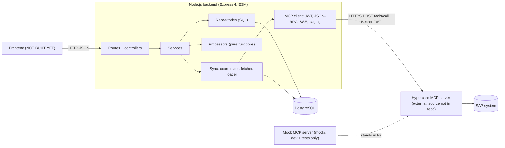
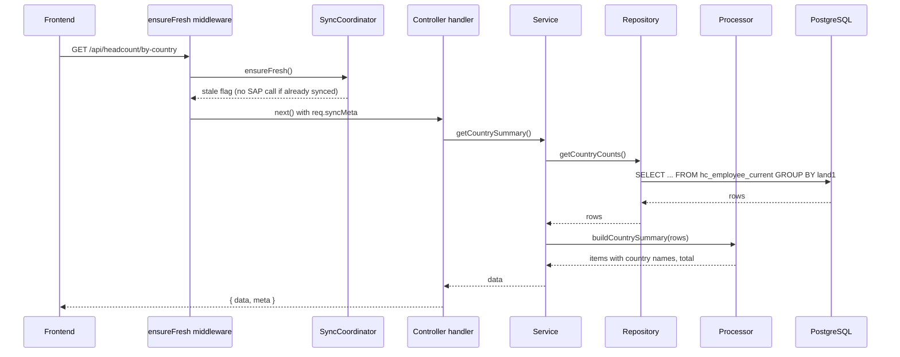
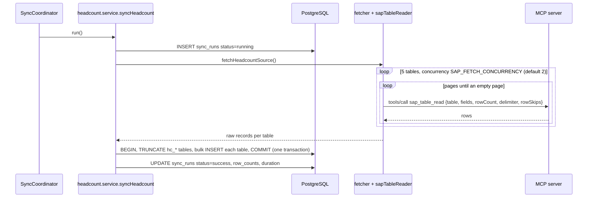
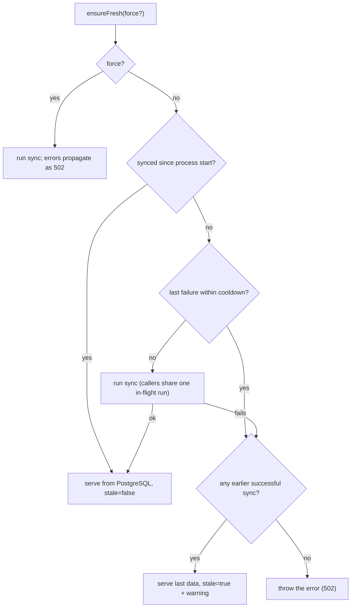

# System Architecture

## 1. Overview

Two independent paths exist:

- **Write path (sync):** SAP → MCP server → MCP client → fetcher → loader → PostgreSQL staging tables. Triggered by first read / `POST /sync` / `?refresh=true`.
- **Read path (KPI APIs):** HTTP → controller → service → repository (SQL on staging tables and the view) → processor → JSON. Never calls SAP directly.

## 2. Components and responsibilities

| Component | Location | Responsibility |
|---|---|---|
| Entry point | `src/server.js` | Run migrations, mark interrupted sync runs failed, start HTTP server, graceful shutdown (SIGINT/SIGTERM, 10 s force-exit) |
| App wiring | `src/app.js` | CORS, JSON body parser, `/health`, module registration, 404 + error handler |
| Config | `src/config/env.js`, `src/config/db.js` | All env vars with defaults; `pg` pool, date/int8 type parsers, `withTransaction` |
| Migrations | `src/db/migrate.js`, `src/db/migrations/*.sql` | Create DB if missing, apply SQL files in order, track in `schema_migrations` |
| MCP integration | `src/integrations/mcp/` | `mcpClient.js` (transport/auth), `sapTools.js` (tool wrappers), `sapTableReader.js` (paging + response normalisation) |
| KPI module | `src/modules/headcount/` | constants, fetcher, loader, repository, processor, service, controller, routes |
| Module registry | `src/modules/index.js` | One `app.use` line per KPI section |
| Sync control | `src/shared/sync/` | `SyncCoordinator` (when to fetch), `syncRuns.repository.js` (history in `sync_runs`) |
| Shared utilities | `src/shared/` | `AppError` family, `errorHandler`, `bulkInsert`, `mapLimit`, SAP value converters, country-name lookup + data |
| Mock MCP | `mock/` | Stand-in for the real server; synthetic dataset |
| Diagnostics | `scripts/inspect-table.js` | Print raw and normalised `sap_table_read` output from a real server |

## 3. How the Node.js backend works

- Express 4 app, plain JavaScript ES modules. Routes live under `/api/<module>`; currently only `/api/headcount`, plus `GET /health`.
- Each module's router first declares sync-control routes (`POST /sync`, `GET /sync/status`), then `router.use(ensureFresh)`, then the KPI reads.
  `ensureFresh` (middleware in `headcount.controller.js`) makes sure data was fetched at least once since server start, and attaches
  `req.syncMeta = { lastSyncedAt, stale, warning? }`.
- Handlers are `async` functions wrapped by `asyncHandler`; thrown errors reach `errorHandler`.
- `server.js` runs `runMigrations()` on every start, so a fresh database is created and migrated automatically (if the DB user may create databases).

## 4. API request/response flow (read)

## 5. Sync flow (first read after server start, or forced)

If any step fails, the transaction is rolled back (previous data survives), `sync_runs` is marked `failed` with the error, and the error propagates.
Nothing is written to PostgreSQL until **all five tables** have been read from SAP.

## 6. Freshness model (SyncCoordinator)

Key points: state is **in memory per process** (`#syncedThisProcess`, `#lastFailureAt`, in-flight promise). The cooldown is `SYNC_RETRY_COOLDOWN_MS` (default 60 000 ms).
With several server instances each would fetch on its first read (no cross-process lock).

## 7. External services and integrations

| Integration | Direction | Notes |
|---|---|---|
| Hypercare MCP server | Outbound HTTPS | URL in `MCP_URL` (default `https://localhost:8000/hypercare-mcp`). Source code, host and deployment: UNKNOWN. See [MCP_SERVERS.md](MCP_SERVERS.md) |
| SAP system | Indirect (via MCP server) | Credentials travel inside the JWT to the MCP server, which connects to SAP (RFC-style fields: `ashost`, `sysnr`, `client`, ...; optional HTTP block) |
| PostgreSQL | Outbound TCP | `pg` pool (max 10). Config via `DATABASE_URL` or `PG*` variables |
| Frontend | Inbound HTTP | Not built. CORS is open (`*`) by default |
| Anthropic/Claude | None at runtime | The app does not call any LLM. See MCP_SERVERS.md section on "Claude configuration" |

## 8. Authentication and authorization

| Boundary | Mechanism | Status |
|---|---|---|
| Backend → MCP server | `Authorization: Bearer <HS256 JWT>`; payload `{ sap: {...credentials}, exp }`; signed with `MCP_JWT_SECRET` using Node `crypto`; token cached and renewed 60 s before expiry (TTL `MCP_TOKEN_TTL_SECONDS`, default 3600) | IMPLEMENTED (mirrors the owner's Python script, except `exp`) |
| MCP server → SAP | Credentials from the JWT `sap` claim | Server-side; UNKNOWN details |
| Frontend → backend API | **None.** No authentication, no authorization, no rate limiting | NOT IMPLEMENTED |
| Backend → PostgreSQL | DB user/password from env; `PGSSL=true` enables TLS with `rejectUnauthorized: false` | IMPLEMENTED (weak TLS verification option) |

Security notes: the JWT is signed, not encrypted, and contains the SAP password; the staging tables hold PERNR-level HR data; API CORS defaults to `*`.
Add API authentication before exposing this beyond a trusted network.

## 9. Design principles in force

1. SAP is read **only** during a sync; KPI reads are SQL on PostgreSQL.
2. **Atomic replace**: a failed sync never leaves half-loaded data.
3. SQL does joins/dedup/aggregation; Node does presentation shaping; processors are pure and unit-testable.
4. Fail loudly on unrecognised MCP data rather than silently reporting zeros.
5. One folder per KPI section; adding a section is additive (new folder, new migration, one registry line).
